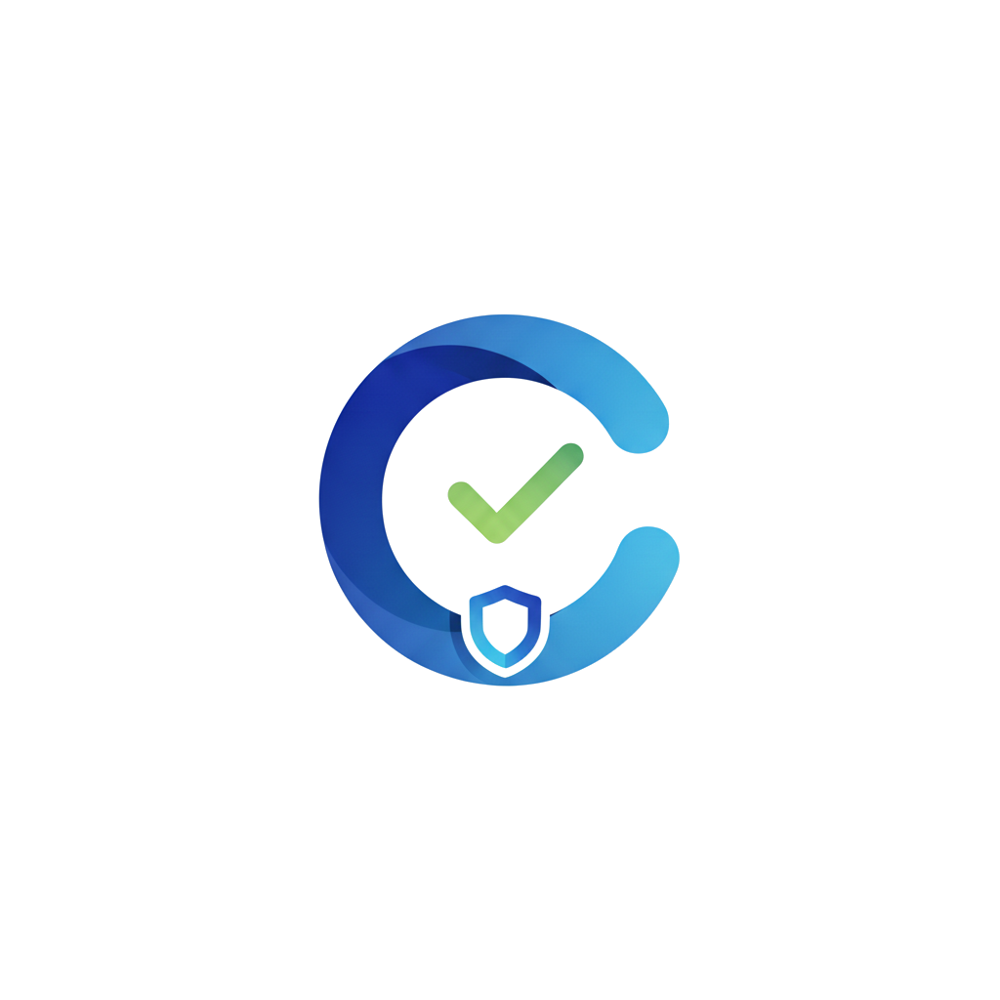
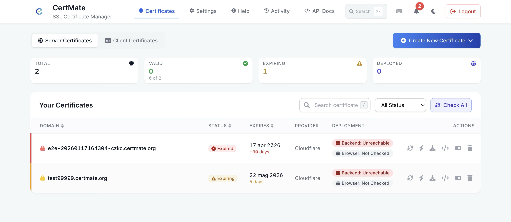

# CertMate

<div align="center">



**The self-hosted control plane for your TLS certificates, ready for 47-day certificates.**

CertMate issues and renews certificates, finds the ones you did not issue, keeps
one inventory of what is served where, who issued it and when it expires, and
deploys each renewed certificate to where it is served. It runs on your own
infrastructure, with a web interface, a REST API, a CLI and an MCP server for AI
agents.

[](https://demo.certmate.org)
[](https://www.youtube.com/playlist?list=PLM-wnWN4g5XA)
[](https://opensource.org/licenses/MIT)
[](https://www.python.org/downloads/)
[](https://hub.docker.com/r/fabriziosalmi/certmate)
[](https://pypi.org/project/certmate-cli/)
[](https://github.com/fabriziosalmi/certmate/actions/workflows/ci.yml)
[](https://github.com/fabriziosalmi/certmate/actions/workflows/codeql.yml)
[](https://securityscorecards.dev/viewer/?uri=github.com/fabriziosalmi/certmate)
[](https://codecov.io/gh/fabriziosalmi/certmate)
[](https://europeanopensource.eu/)



[Quick start](#quick-start-with-docker) • [Documentation](#documentation) • [Live demo](https://demo.certmate.org) • [Video guide](https://www.youtube.com/playlist?list=PLM-wnWN4g5XA) • [API reference](docs/api.md)

</div>

## Ready for 47-day certificates

Publicly trusted certificates are getting shorter: 200 days at most since
15 March 2026, 100 days from 15 March 2027, and 47 days from 15 March 2029
(CA/Browser Forum ballot SC-081). At that pace a renewal nobody watches is an
outage waiting for a date. CertMate is built for it:

- **One renewal rule for every lifetime.** Each certificate says when it renews
  (`renews_at`), and the CA can move that date through ARI, its renewal
  information. See [when a certificate renews](docs/guide.md#when-a-certificate-renews).
- **Short certificates today.** Ask Let's Encrypt for its 45-day or 160-hour
  [ACME profiles](docs/api.md#acme-profiles) now, rather than in 2029.
- **Renewed is not done.** [Deploy hooks](docs/deploy-hooks.md) and
  [webhooks](docs/webhooks.md) put the new certificate where it is served, and
  [deployment probes](docs/probes.en.md) check that it is.
- **No certificate left behind.** [Discovery](docs/discovery-inventory.md) finds
  the certificates you did not issue, through probes and Certificate
  Transparency logs, and keeps them in one inventory.

## What it does

- **Issues** from Let's Encrypt, ZeroSSL, Google Trust Services, Actalis,
  DigiCert, Sectigo and SSL.com, or from a private CA of its own: wildcard and
  multi-name certificates, DNS-01 through 29 DNS providers, HTTP-01, DNS
  validation through an alias zone, or from a CSR whose key never leaves the
  device. See [CA providers](docs/ca-providers.md),
  [DNS providers](docs/dns-providers.md) and
  [CSR-only certificates](docs/csr-only-certificates.md).
- **Controls access** with three roles, API keys restricted to domains, single
  sign-on through [OIDC](docs/sso.md), and a tamper-evident audit chain with a
  signed export ([compliance](docs/compliance.md)).
- **Keeps** certificates on local disk, with a copy in Azure Key Vault, AWS
  Secrets Manager, HashiCorp Vault, Infisical or S3-compatible storage
  ([storage](docs/storage.md)), and takes encrypted backups with an off-site
  copy ([backups](docs/backup.md)).
- **Tells you** through eight notification channels, Prometheus metrics with a
  ready dashboard and alert rules, and health endpoints
  ([monitoring](docs/monitoring.md)).
- **Issues client certificates** from its own CA, for mTLS and VPNs, with OCSP
  and a CRL ([client certificates](docs/guide.md)).

**CertMate runs as a single instance.** Its renewal scheduler runs inside the
web process, so a second replica would be a second scheduler issuing against the
same certificates, and the Helm chart refuses to render more than one. It scales
up, not out; for availability, run active and standby on shared storage, as
[Availability and failover](docs/architecture.md#availability-and-failover)
describes.

## Quick start with Docker

One file, the published image, nothing to build. You need Docker with Compose
v2, and a domain whose DNS is at a [supported provider](docs/dns-providers.md).

### 1. Download and configure

```bash
mkdir certmate && cd certmate
curl -fsSLO https://raw.githubusercontent.com/fabriziosalmi/certmate/main/deploy/docker-compose.yml
printf 'API_BEARER_TOKEN=%s\nSECRET_KEY=%s\nCERTMATE_BACKUP_PASSPHRASE=%s\n' \
  "$(openssl rand -hex 32)" "$(openssl rand -hex 32)" "$(openssl rand -hex 32)" > .env
chmod 600 .env
```

`.env` holds the three secrets CertMate needs: the API token (the first-run
screen asks for it once, to create the administrator), the session signing key,
and the backup passphrase, without which automatic backups cannot restore the
instance. Optionally add `CLOUDFLARE_TOKEN=...` to bootstrap a Cloudflare DNS
account; every other provider is configured in the web interface.

### 2. Start

```bash
docker compose up -d
docker compose logs -f certmate
```

CertMate listens on `127.0.0.1:8000`. For remote access, put a reverse proxy in
front and set `BEHIND_PROXY=true` in `.env`; see [Docker](docs/docker.md).

### 3. Issue a certificate

Open `http://localhost:8000`, create the administrator, add your DNS provider in
Settings, then create a certificate. Or through the API:

```bash
curl -X POST http://localhost:8000/api/certificates/create \
 -H "Authorization: Bearer $(grep API_BEARER_TOKEN .env | cut -d= -f2)" \
 -H "Content-Type: application/json" \
 -d '{"domain": "app.example.com"}'
```

## Other ways to run it

- **Linux with systemd:** `curl -fsSL https://raw.githubusercontent.com/fabriziosalmi/certmate/main/deploy/install.sh | sudo sh`
  installs it with its own Python 3.12 and starts the service. See
  [installation](docs/installation.md#linux-server-with-systemd).
- **Kubernetes:** the Helm chart, `oci://ghcr.io/fabriziosalmi/charts/certmate`,
  with one replica by design. See [Kubernetes](docs/kubernetes.md).
- **From source,** for development: see [installation](docs/installation.md) and
  [testing](docs/testing.md).

Every setting is in [configuration](docs/configuration.md).

## Automating it

The [REST API](docs/api.md) is what the web interface uses. The two calls most
automation needs:

```
POST /api/certificates/create
GET  /api/certificates/{domain}/download/{cert|chain|fullchain|privkey|combined}
```

From a terminal or from Python, `pip install certmate-cli` gives the `certmate`
command and the [SDK](clients/README.md) under it:

```bash
export CERTMATE_URL=https://certmate.example.com CERTMATE_TOKEN=...
certmate cert create app.example.com --dns cloudflare --wait
```

## AI agents (MCP server)

CertMate ships a Model Context Protocol server, so an assistant can drive the
same API with the same roles and the same audit trail. It exposes **16 tools**,
from listing certificates to issuing, renewing and deploying them. Give it a
scoped API key created with `is_agent: true`, so the audit chain records its
actions as an agent's. See [the MCP guide](docs/mcp.md).

## Documentation

| Page | What it covers |
| --- | --- |
| [Installation](docs/installation.md) | Linux installer, cloud-init, manual setup, reverse proxy, egress |
| [Docker](docs/docker.md) | Compose bundle, images, building multi-platform |
| [Kubernetes](docs/kubernetes.md) | Helm, Argo CD, Flux, sizing |
| [Configuration](docs/configuration.md) | Every environment variable |
| [CA providers](docs/ca-providers.md) | Let's Encrypt, ZeroSSL, DigiCert, Sectigo, private CA |
| [DNS providers](docs/dns-providers.md) | Every provider, its credentials, multi-account, availability |
| [Custom DNS script](docs/custom-dns-script.md) | Any provider with no plugin |
| [Client certificates](docs/guide.md) | mTLS and VPN client certificates, renewal timing |
| [CSR-only certificates](docs/csr-only-certificates.md) | Issuing when the key stays on the device |
| [Discovery and inventory](docs/discovery-inventory.md) | Probes, CT logs, adopting, crypto readiness |
| [Deploy hooks](docs/deploy-hooks.md) | Commands after issuance and renewal |
| [Webhooks](docs/webhooks.md) | Payload templates, authentication, signatures |
| [Deployment probes](docs/probes.en.md) | Checking a renewed certificate is served |
| [Storage](docs/storage.md) | Storage backends and migration |
| [Backups](docs/backup.md) | Backups, restoring, lost admin password |
| [Monitoring](docs/monitoring.md) | Health endpoints, metrics, logs, notifications |
| [Single sign-on](docs/sso.md) | OpenID Connect |
| [Compliance](docs/compliance.md) | Audit chain, attribution, NIS2 and eIDAS |
| [API reference](docs/api.md) | Every endpoint, its role and its answers |
| [MCP server](docs/mcp.md) | Tools, attribution, safety |
| [Architecture](docs/architecture.md) | Design, components, availability |
| [Troubleshooting](docs/troubleshooting.md) | Common failures, debug logging, bug reports |
| [Testing](docs/testing.md) | The test suite and CI |

Most pages are also in German, Spanish, French and Italian, under
[docs/de](docs/de/), [docs/es](docs/es/), [docs/fr](docs/fr/) and
[docs/it](docs/it/).

## Project

- **Ecosystem:** [certmate-tools](https://github.com/fabriziosalmi/certmate-tools)
  (client-side TLS and ACME diagnostics in the browser),
  [certmate-agent](https://github.com/fabriziosalmi/certmate-agent) (an assistant
  over the documentation),
  [nis2-public](https://github.com/fabriziosalmi/nis2-public) (NIS2 posture
  management).
- **Support and enterprise:** paid support, custom development and security
  consulting are available, and multi-tenant and white-label deployments as
  CertMate-ng (source-available, BSL 1.1). Write to
  [fabrizio.salmi@gmail.com](mailto:fabrizio.salmi@gmail.com).
- **Contributing:** see [CONTRIBUTING.md](CONTRIBUTING.md). Security reports go
  through [SECURITY.md](SECURITY.md).
- **License:** [MIT](LICENSE).
